  

  

  
  
  
  

## 📜 Captain's Log

<table>
  <td>
  <tr>

**Ahoy! I'm Sathvik** — a Computer Science student at **Newton School of Technology × Rishihood University**, Sonipat, who builds full-stack products and the AI that sails inside them.

- 🧪 **Research AI/ML Intern at Mstack** *(current)* — building **LLM pipelines on Temporal** that extract chemistry reactions from papers (**73% F1** vs 50.8% for Reaxys); benchmarked LLM, OCR and embedding models, cutting projected costs by **~98%**
- ⚓ **SDE Intern at Prodoc AI** — shipped real-world **AI-driven tools** and **backend systems**
- 🧭 Building **agentic AI**: LangGraph workflows, RAG pipelines and LLM-powered decision systems
- 🗺️ Full-stack crew member: **React · Node.js · Express · MongoDB · TypeScript**
- ⚔️ **350+ LeetCode problems** solved · **Codeforces 757+**
- 🎓 **8.69 SGPA** in my first semester
- 🏴‍☠️ Grew in communication, collaboration and time management with the **Neutron 2.0** crew
- 🏸 Off the ship: **badminton**, **cricket** and **lawn tennis**

> *"Every bug is just another sea king between me and the next island."*

</td>
</tr>
</table>

## ⚗️ Current Voyage — Research AI/ML Intern @ Mstack

Mstack is an AI-native chemical manufacturer that uses AI to work out how to make a target molecule, cutting route-scouting time by 90%.

- Working on **LiteratureIQ**, an AI chemistry-literature extractor — an **LLM pipeline on Temporal workflows**, doing prompt and context engineering with LiteLLM, OpenRouter, Azure Blob, Vault, Grafana and Langfuse
- Built **ThomasScribe**, a molecule-structure-image-to-SMILES microservice (MolDetect + MolScribe + RxnScribe), improving labelled-molecule recovery by **~88%**
- Built the **journal extraction pipeline**: OpenAlex paper discovery, section-wise reaction extraction as Temporal child workflows — **73.0% F1 vs 50.8% for Reaxys** on a hand-checked answer set
- Debugged and fixed production pipeline failures, stabilising on staging before prod
- Built a **Claude Code pipeline** that turns a patent ID into a gold evaluation dataset (headless on VMs), plus an **annotator platform** to verify it
- Benchmarked open-weight LLMs vs Claude Sonnet 4.5 on our own gold set and switched to **GLM-5.2**, cutting LLM cost by **~80%** at matching quality
- Benchmarked OCR, translation and embedding models — picked PaddleOCR-VL, GLM-5.2 and BGE-M3, cutting projected cost for 66M patents from **~$29M to ~$0.47M (~98%)**
- Researched **knowledge graphs for chemistry** (PubChemRDF, The World Avatar) and building a **benchmarking & pipeline-evaluation platform** that automates all of the above

## 🧭 Log Pose — what I'm navigating now

| Heading | Course |
| :-- | :-- |
| 🤖 **Agentic AI** | Multi-step agents with human-in-the-loop control, built on LangGraph |
| 📚 **Retrieval systems** | RAG over PDFs, notes and case files — semantic search, re-ranking, cited answers |
| 👁️ **Vision + LLMs** | Real-time detection (YOLO) feeding LLM risk assessment and automated response |
| 🏗️ **Production full-stack** | Role-based apps with JWT auth, REST APIs, and clean React front ends |

## 🍈 Devil Fruit Arsenal

  

| Fruit | Power |
| :-: | :-- |
| 🔥 **Mera Mera no AI** |       |
| 🌊 **Mizu Mizu no Data** |      |
| ⚡ **Goro Goro no Stack** |       |
| ⚓ **Ope Ope no Ops** |     |

## 🗺️ Voyage Log

### 🌋 New World — AI & Agents

| Island | What it does | Treasure map |
| :-- | :-- | :-: |
| 🛡️ **[Sentinel](https://github.com/sathvik89/Sentinel_project)** | Real-time public-safety AI: YOLO detects threats in CCTV feeds, an LLM assesses risk, and responses are dispatched automatically — with a Flask dashboard | [Code](https://github.com/sathvik89/Sentinel_project) |
| 🧹 **[Clean.ai](https://github.com/sathvik89/Clean.ai)** | Agentic data cleaning on LangGraph: analyses raw data, plans a strategy, and transforms it with human approval at every step | [Live](https://clean-ai-v1.streamlit.app/) · [Code](https://github.com/sathvik89/Clean.ai) |
| 🕵️ **[Cold Case Investigator](https://github.com/sathvik89/Cold_Case_detective)** | Retrieval-augmented investigator over case files — finds the strongest evidence and writes a report citing every source | [Code](https://github.com/sathvik89/Cold_Case_detective) |
| 📊 **[Competitor Research Assistant](https://github.com/sathvik89/Competitor_Research)** | Compares startups across sectors and exports a downloadable research report | [Live](https://competitor-researchassistant.streamlit.app/) · [Code](https://github.com/sathvik89/Competitor_Research) |
| 📄 **[Know Your PDF (RAG)](https://github.com/sathvik89/RAG)** | PDF question answering with FAISS search, cross-encoder re-ranking and Groq generation | [Live](https://knowyour-pdf.streamlit.app/) · [Code](https://github.com/sathvik89/RAG) |
| 🗒️ **[Notion RAG](https://github.com/sathvik89/Notion_Rag)** | Personal knowledge base: semantic search over your notes with Pinecone and GPT-4 answers | [Code](https://github.com/sathvik89/Notion_Rag) |

### 🧪 Navigator's Charts — Machine Learning

| Island | What it does | Treasure map |
| :-- | :-- | :-: |
| 🚀 **[Kickstarter Funding Predictor](https://github.com/sathvik89/kickstarter-funding-prediction)** | Predicts campaign success using only pre-launch data — fuses TF-IDF text with tabular features, leakage-free, **70.7%** test accuracy, runs entirely in the browser | [Live](https://sathvik89.github.io/kickstarter-funding-prediction/) · [Code](https://github.com/sathvik89/kickstarter-funding-prediction) |
| 🎓 **[Learning Analytics & AI Study Coach](https://github.com/sathvik89/Predictive-Learning-Analytics_ML)** | Predicts exam scores and pass/fail, segments learners, and adds an agentic study coach | [Live](https://predictive-learning-analytics-ml.streamlit.app/) · [Code](https://github.com/sathvik89/Predictive-Learning-Analytics_ML) |

### ⛵ Grand Line — Full-Stack Products

| Island | What it does | Treasure map |
| :-- | :-- | :-: |
| 🏥 **[MediQueue](https://github.com/sathvik89/MediQueue)** | Hospital queue & appointment system for patients, doctors and admins — TypeScript, React, Express, MongoDB | [Live](https://medi-queue-indol.vercel.app/) · [Code](https://github.com/sathvik89/MediQueue) |
| 📚 **[Library Space](https://github.com/sathvik89/library_frontend)** | Library management for Rishihood: book circulation, waitlists, fines, and seat/cabin booking with QR check-ins | [Live](https://library-space-rishihood.vercel.app) · [Code](https://github.com/sathvik89/library_frontend) |
| 🔐 **[Scalable Auth + Task API](https://github.com/sathvik89/scalable-auth-crud-api)** | JWT auth with role-based access and user-scoped task CRUD — documented in Postman | [Live](https://scalable-auth-crud-api.vercel.app/) · [Docs](https://documenter.getpostman.com/view/43708069/2sBXqCPPoN) |

### 🏝️ East Blue — Where it started

| Island | What it does | Treasure map |
| :-- | :-- | :-: |
| 🎮 **[Blink Tac Toe](https://github.com/sathvik89/BlinkTacToe)** | Emoji-powered Tic Tac Toe with animations, sound and multi-round play — React, Tailwind, Framer Motion | [Live](https://blink-tac-toe-seven.vercel.app) · [Code](https://github.com/sathvik89/BlinkTacToe) |

## ⚔️ Bounty Board

  
  
  

  
  

  

## 🐌 Den Den Mushi — Let's connect

I'm always up for building with people who love tech as much as I do — internships, collaborations, or just talking agents and RAG.

  
  
  

  

